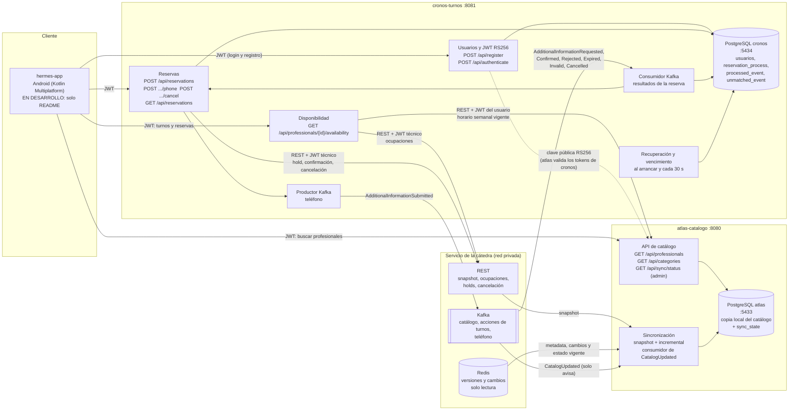
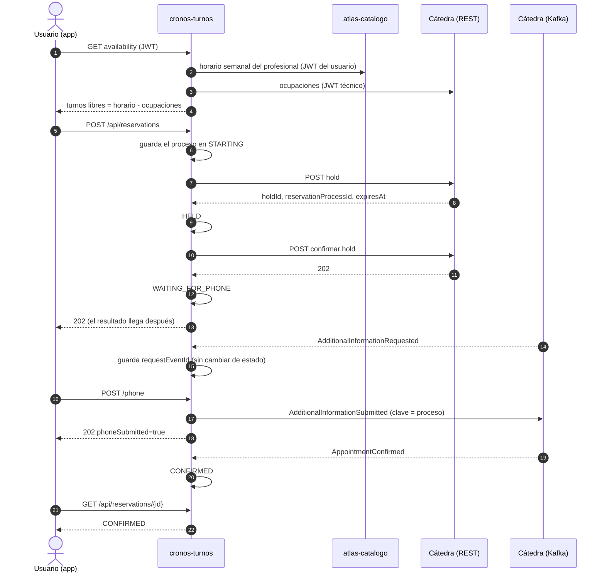
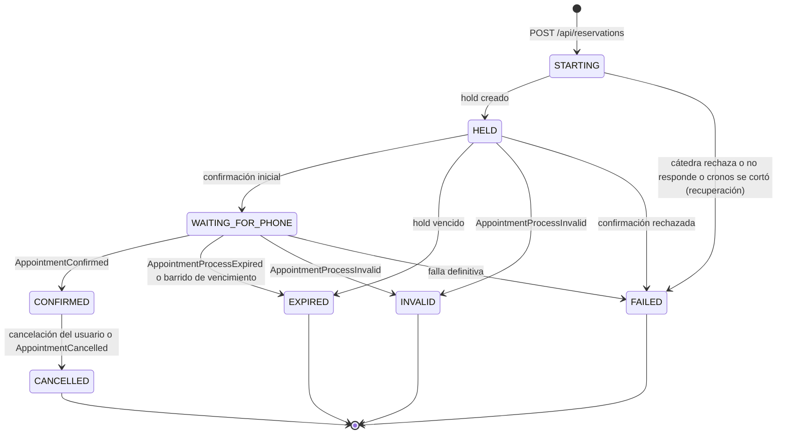

# Arquitectura general del sistema

**Actualizado:** 2026-11-22 · **Cubre:** el diagrama de arquitectura que pide el enunciado (sección 12): la aplicación Android, los dos servicios backend, sus bases de datos y las integraciones con el servicio de la cátedra.

Cada afirmación de este documento está contrastada con el código de `dev` en el commit `0b0f2f1` de cronos-turnos y con la corrida real del 2026-11-22 ([evidencia](../evidencias/isla-2-corrida-real-kafka.md)). Lo que no está hecho se marca como tal.

## Diagrama de componentes

Lectura del diagrama:

- **Cada servicio es dueño exclusivo de su base.** Atlas no lee las tablas de cronos ni al revés; se hablan solo por la API con JWT. La única llamada de servicio a servicio es la de disponibilidad, de cronos a atlas, y lleva el JWT del propio usuario ([ADR 0004](adr/0004-autenticacion-entre-servicios.md)).
- **Cronos emite los JWT** (RS256, clave privada solo en cronos). Atlas los valida con la clave pública y no tiene usuarios propios ([ADR 0005](adr/0005-usuarios-y-jwt-en-cronos-sin-jhipster.md)).
- **La cátedra no conoce a los usuarios finales**: solo a la cuenta técnica del proyecto. La propiedad de cada reserva por usuario vive en cronos, y es lo que impide que un usuario vea o cancele la reserva de otro.
- **Las tres vías hacia la cátedra son distintas a propósito:** REST para operar (con efectos), Redis para leer el catálogo vigente, Kafka para enterarse de lo que pasa después.

## Quién es dueño de qué

| Dato | Dueño | Dónde vive | Quién más lo ve |
|---|---|---|---|
| Catálogo (categorías, profesionales, horarios semanales) | La cátedra | Copia local en la base de atlas | Cronos lo pide a atlas, nunca a la cátedra |
| Ocupaciones, holds y reservas confirmadas | La cátedra | Servicio de la cátedra | Cronos las consulta por REST y se entera por Kafka |
| Usuarios y roles | Cronos | `app_user`, `user_authority` | Atlas solo recibe el JWT firmado |
| Proceso de reserva de un usuario y su estado | Cronos | `reservation_process` | El usuario dueño, nadie más |
| Eventos de Kafka ya aplicados o estacionados | Cronos | `processed_event`, `unmatched_event` | Nadie (solo diagnóstico) |
| Estado de la sincronización | Atlas | `sync_state` | Un administrador por `GET /api/sync/status` |
| El teléfono del paciente | Nadie | **No se guarda**: sale a la cátedra y solo queda `phone_submitted_at` | — |

El detalle de las tablas está en el [modelo de datos de cronos](../modelo-datos/cronos-turnos.md) y el [de atlas](../modelo-datos/atlas-catalogo.md).

## Secuencia de una reserva (camino feliz, probado con la cátedra real)

Puntos que explican las decisiones:

- **El estado local se guarda antes de cada paso con efectos** (`STARTING` antes de pedir el hold; `HELD` antes de confirmarlo) y nunca dentro de una transacción mientras se espera a la red. Si cronos se corta, queda un rastro desde el que se puede recuperar.
- **El mensaje de Kafka puede llegar antes de que cronos termine de guardar la respuesta REST** (pasó de verdad en la corrida real: el pedido de teléfono llegó al segundo). Está resuelto y probado; ver [idempotencia y recuperación](idempotencia-y-recuperacion-cronos.md).
- **El usuario nunca espera a Kafka.** `POST /api/reservations` responde `202` con el estado local; el resultado final se consulta.

## Máquina de estados de una reserva

- Los estados finales (`EXPIRED`, `INVALID`, `FAILED`, `CANCELLED`) **no admiten ninguna transición**: un evento tardío no puede reabrirlos. `CONFIRMED` solo puede pasar a `CANCELLED`.
- **No existe un estado `REJECTED`:** un `AdditionalInformationRejected` deja el proceso en `WAITING_FOR_PHONE` con el motivo guardado, porque la referencia de la cátedra (15.7) lo mantiene vivo hasta `expiresAt` y permite mandar otro teléfono.

## Cómo corre

| Pieza | Puerto | Base | Arranque |
|---|---|---|---|
| atlas-catalogo | 8080 | PostgreSQL 5433 (`compose.yaml` del repo) | `./gradlew bootRun` |
| cronos-turnos | 8081 | PostgreSQL 5434 (`compose.yaml` del repo) | `./gradlew bootRun` |
| hermes-app | — | — | Sin código todavía |

Los pasos reproducibles, la configuración (`.env.example`) y los comandos de prueba están en el README de cada repositorio. Los secretos (token técnico, claves, `groupId`) viven en el `.env` local de cada servicio y nunca en el repositorio ([ADR 0001](adr/0001-configuracion-y-secretos.md)).

## Estado de cada pieza

| Pieza | Estado | Evidencia |
|---|---|---|
| atlas-catalogo | Hecha: snapshot, incremental, búsqueda, seguridad | [isla 1](../evidencias/isla-1-sync-incremental.md), [prueba cruzada](../evidencias/isla-2-prueba-cruzada.md) |
| cronos-turnos | Hecha: usuarios, disponibilidad, holds, Kafka (consumidor y teléfono), consulta, cancelación, recuperación. Falta el usuario administrador (opcional) | [corrida real](../evidencias/isla-2-corrida-real-kafka.md) |
| hermes-app | **Sin hacer**: solo README y `.env.example`. El profesor indicó que no es la prioridad | — |

## Seguridad en una mirada

- **Autenticación:** JWT RS256 emitido por cronos; atlas valida firma, vencimiento y roles. Sin token, `401`; con rol insuficiente, `403`.
- **Autorización por dueño:** una reserva ajena y una inexistente dan el mismo `404`; el listado solo devuelve las propias.
- **Cátedra:** cuenta técnica con token propio, solo desde cronos y atlas, nunca desde la app.
- **Datos personales:** el teléfono no se guarda ni se registra; los nombres del paciente no llegan a los logs; el `groupId` y los nombres de topic no se escriben ([ADR 0006](adr/0006-norma-de-logs.md)).
- **Límite conocido:** HTTP y Kafka sin cifrar en desarrollo (la cátedra no pide TLS ni autenticación en Kafka). Detalle en [seguridad de atlas](seguridad-atlas-catalogo.md) y en el README de cronos.
